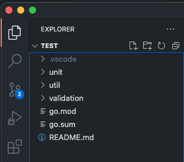
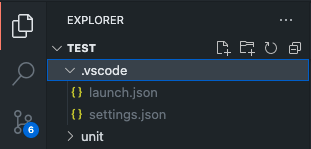
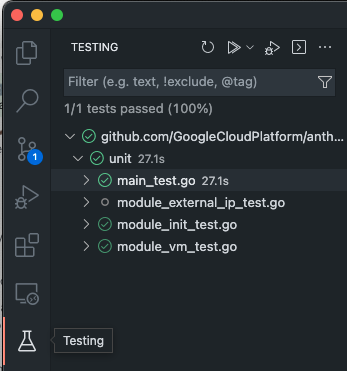
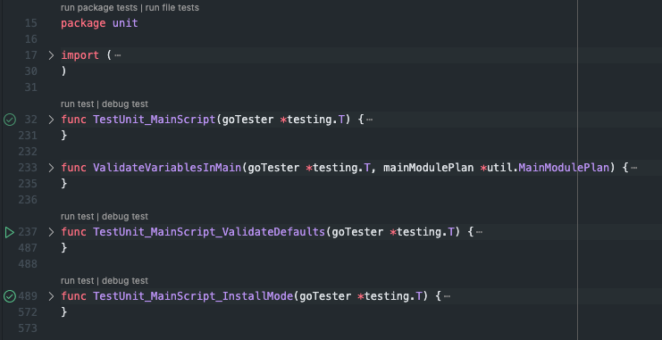

# Golang unit tests

### Run existing tests
- To run the existing tests you have to set two environment variables
```bash
export GOOGLE_CLOUD_PROJECT="<YOUR_GOOGLE_CLOUD_PROJECT>"
export GOOGLE_APPLICATION_CREDENTIALS="<PATH_TO_THE_SERVICE_ACCOUNT_KEY_FILE>"
```
> Note: If `GOOGLE_APPLICATION_CREDENTIALS` is unset (such as in GitHub Actions CI), tests that query live Compute Engine zones (`main_test.go`, `main_custom_mode_test.go`, and `module_vm_test.go`) are skipped while offline Terraform plan unit tests still execute.
- Move into the test directory and recursively execute the tests
```bash
cd anthos-bm-gcp-terraform/test
go test -v -timeout 30m ./...
```
---

### Setup [`vscode`](https://code.visualstudio.com/) to run unit tests

- Open  [anthos-bm-gcp-terraform/test](/anthos-bm-gcp-terraform/test) directory in `vscode`

    <p>
        
        <em>
        </br>
        <b>The test directory must be the root directory in the vscode workspace</b>
        </em>
    </p>

- Create a directory called `.vscode` at the root of the workspace and add two
  files inside it: `launch.json` & `settings.json`

    <p>
        
        <em>
        </em>
    </p>

- Update the two files to have the following configurations:

    ```sh
    # launch.json
    {
        "configurations": [
            {
                "name": "Launch Package",
                "type": "go",
                "request": "launch",
                "mode": "auto",
                "program": "${fileDirname}",
                "env": {
                    "GOOGLE_PROJECT": "<YOUR_GCP_PROJECT>",
                    "GOOGLE_APPLICATION_CREDENTIALS": "<PATH_TO_GCP_SERVICE_ACCOUNT_KEY>",
                },
            }
        ]
    }
    ```

    ```sh
    # settings.json
    {
        "go.testEnvVars": {
            "GOOGLE_CLOUD_PROJECT": "<YOUR_GCP_PROJECT>",
            "GOOGLE_APPLICATION_CREDENTIALS": "<PATH_TO_GCP_SERVICE_ACCOUNT_KEY>",
        }
    }
    ```

- Now you must be able to trigger tests from the `Testing` plugin in vscode or the
  options available above the test methods in the code editor.

    <p>
        
        <em>
        </em>
    </p>
    <p>
        
        <em>
        </em>
    </p>
